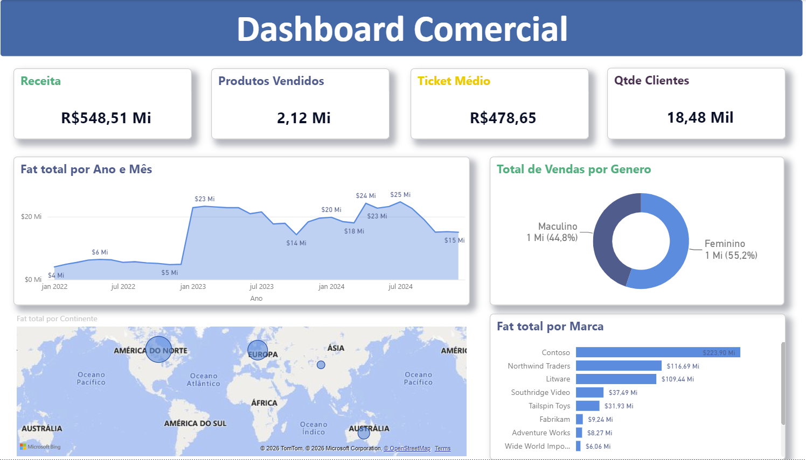
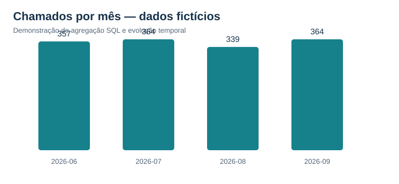
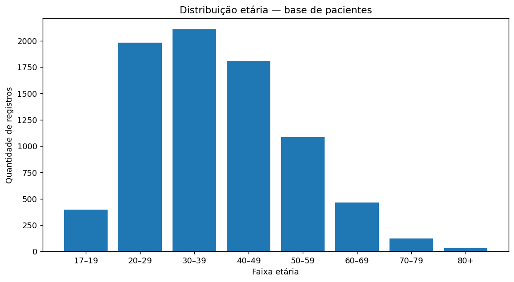
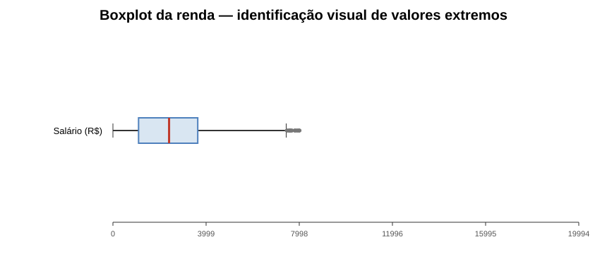
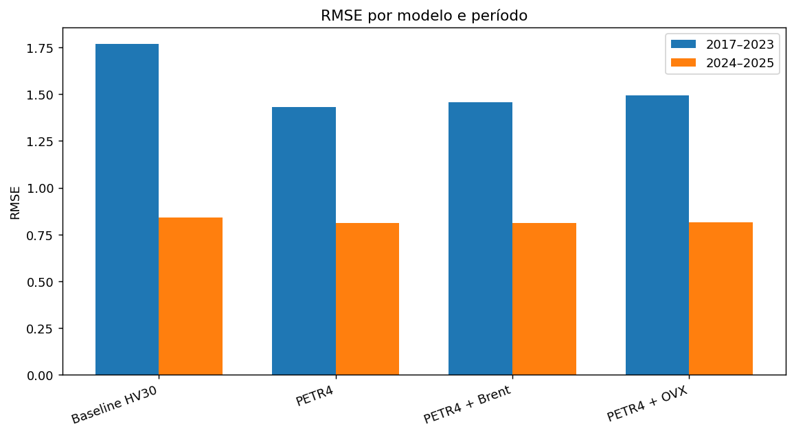

# Portfólio de Análise de Dados, BI e Séries Temporais

Projetos independentes de **Análise de Dados, Business Intelligence e Python**, demonstrando preparação e integração de dados, exploração estatística, construção de indicadores, dashboards e modelagem preditiva.

O portfólio reúne problemas práticos, métodos de análise, dashboards e resultados que ilustram a aplicação das tecnologias em diferentes cenários.

## Comece por aqui

| Área | Projeto | O que permite analisar |
|---|---|---|
| **BI comercial** | [Dashboard Comercial — Power BI](powerbi/dashboard-comercial/README.md) | Receita, ticket médio, desempenho por marca, região e perfil de clientes |
| **BI gerencial e operacional** | [Falsificações — Power BI](powerbi/falsificacoes/README.md) | Distribuição temporal, geográfica e por denominação, em níveis estratégico, tático e operacional |
| **Indicadores educacionais** | [ProUni — Power BI](powerbi/prouni/README.md) | Bolsas por período, curso, instituição, modalidade e perfil |
| **Indicadores financeiros** | [Ranking de Estratégias — Power BI](powerbi/ranking-estrategias/README.md) | Comparação de resultados e evolução de estratégias |
| **Dados públicos e visualização** | [Dengue no Brasil — Tableau](tableau/dengue-brasil/README.md) | Séries históricas e distribuição regional de casos |
| **Python e ETL** | [Dados clínicos e demográficos — notebook](projetos/01_ETL_EDA_Dados_Clinicos.ipynb) | Integração de fontes, valores ausentes, distribuições e possíveis valores extremos |
| **Séries temporais** | [PETR4, Brent e OVX — notebook](projetos/02_MD_PETR4_Brent_OVX.ipynb) | Se informações externas acrescentam capacidade preditiva à volatilidade |
| **SQL e gestão de TI** | [Gestão de Serviços de TI — SQL aplicado](sql/operacao_servicos_ti/README.md) | Como transformar chamados fictícios em indicadores de SLA, backlog, demanda e satisfação |

## Dashboards e indicadores

Os dashboards de **Power BI** combinam indicadores gerenciais, filtros e análises por período, produto, região e perfil de clientes.

[**Explorar os quatro dashboards Power BI e suas imagens**](powerbi/README.md) · [**Explorar o painel Tableau sobre dengue**](tableau/dengue-brasil/README.md)

[](powerbi/dashboard-comercial/README.md)

*Exemplo de painel: indicadores comerciais, evolução de receitas e segmentações.*

## SQL aplicado — Gestão de Serviços de TI

Estudo de caso independente com **SQL, modelagem relacional e indicadores gerenciais de serviços de TI**. O projeto apresenta dez consultas executáveis, incluindo `JOIN`, CTEs, funções de janela, rankings, agregações, *views* e inspeção de planos de execução.

O cenário e os **1.424 chamados são totalmente fictícios**, gerados por script. Os resultados documentados demonstram como investigar volume de demanda, cumprimento de metas ilustrativas de SLA, backlog e satisfação.

[**Consultar o case de SQL, suas consultas e resultados**](sql/operacao_servicos_ti/README.md) · [**Ver a interpretação das consultas**](sql/operacao_servicos_ti/RESULTADOS.md)



---

## Resultados e visualizações

A seguir, alguns resultados visuais dos estudos em Python.

### ETL e exploração de dados clínicos e demográficos

| Distribuição das idades | Dispersão dos salários |
| :---: | :---: |
|  |  |

**Interpretação:** o histograma permite analisar a distribuição etária da amostra; o boxplot evidencia dispersão e possíveis observações extremas na variável de renda. Esses indicadores apoiam a identificação de padrões e o tratamento de dados.

### PETR4, Brent e OVX — avaliação temporal



**Interpretação:** a comparação entre o baseline e modelos com variáveis próprias e externas evidencia que incluir Brent ou OVX não implica, por si só, ganho preditivo. A comparação inclui janelas temporais e avaliação fora da amostra.

[Notebook de ETL/EDA](projetos/01_ETL_EDA_Dados_Clinicos.ipynb) · [Notebook PETR4/Brent/OVX](projetos/02_MD_PETR4_Brent_OVX.ipynb)

## Estudos com Python, ETL e séries temporais

### 1. ETL e análise exploratória de dados clínicos e demográficos
📓 `projetos/01_ETL_EDA_Dados_Clinicos.ipynb`

Case introdutório de engenharia e análise de dados com múltiplas fontes.

Principais tópicos:
- leitura e integração de arquivos CSV;
- identificação de valores ausentes;
- junções entre tabelas;
- organização modular de funções em Python;
- preparação dos dados para análises posteriores.

> Estudo com base didática de dados clínicos e demográficos.

---

### 2. PETR4 × Brent × OVX — previsão de volatilidade
📓 `projetos/02_MD_PETR4_Brent_OVX.ipynb`

Estudo independente de dados financeiros, com avaliação temporal de modelos preditivos.

Objetivo:
avaliar se informações externas associadas ao mercado de petróleo acrescentam capacidade preditiva à volatilidade futura da PETR4.

Aspectos metodológicos:
- dados diários de PETR4, Brent e OVX;
- construção temporal de atributos;
- horizonte futuro de cinco pregões;
- comparação com baseline histórico;
- validação *walk-forward*;
- controle explícito de vazamento temporal;
- avaliação por MAE, RMSE e R².

O trabalho evidencia um ponto importante em Ciência de Dados: **relação econômica entre variáveis não implica necessariamente ganho preditivo incremental**.

---

### 3. Aprendizado de Máquina — repositório dedicado

O estudo de **PETR4 e USD/BRL para previsão de volatilidade** está disponível no repositório público [Aprendizado-de-Maquina](https://github.com/alvarobonifacio1980/Aprendizado-de-Maquina), junto a estudos independentes de séries temporais e aprendizado profundo.

[Ver o notebook original de AM](https://github.com/alvarobonifacio1980/Aprendizado-de-Maquina/blob/main/01_previsao_volatilidade/03_AM_PETR4_USDBRL.ipynb)

---

### 4. Estudos independentes de previsão da volatilidade da PETR4

Os experimentos sobre a **variância realizada nos 60 minutos seguintes (RV60)** foram organizados como uma coleção de três estudos resumidos: modelos históricos e Machine Learning, Deep Learning e ensembles com avaliação de robustez.

[**Consultar a coleção PETR4 intradiária**](https://github.com/alvarobonifacio1980/Aprendizado-de-Maquina/tree/main/estudos/petr4_intradiario)

A investigação de **volatilidade diária** é uma linha independente, com horizonte de previsão e técnicas de avaliação próprios.

---

## Como reproduzir os estudos

Requer Python 3.11+ e acesso às fontes de dados quando o notebook utilizar séries adquiridas online. A partir da raiz do repositório:

```bash
python -m pip install -r requirements.txt
python -m jupyter notebook
```

Abra o notebook desejado em `projetos/` e execute suas células na ordem apresentada. As bases didáticas do estudo de ETL estão em `data/raw/`.

O estudo da PETR4 apresenta as fontes históricas e as regras de preparação temporal no notebook.

## Tecnologias

`Python` · `Pandas` · `NumPy` · `Scikit-learn` · `Matplotlib` · `Jupyter Notebook` · `Power BI` · `Tableau` · `SQL`

**SQL demonstrado:** consultas e indicadores gerenciais com dados fictícios, acompanhados de geração automatizada e testes no [case de Gestão de Serviços de TI](sql/operacao_servicos_ti/README.md).

Conceitos aplicados:

`EDA` · `ETL` · `Machine Learning` · `Time Series` · `Walk-Forward Validation` · `Feature Engineering` · `Data Leakage Prevention`

## Estrutura

```text
Analise-de-Dados/
├── projetos/
│   ├── 01_ETL_EDA_Dados_Clinicos.ipynb
│   └── 02_MD_PETR4_Brent_OVX.ipynb
├── data/
│   └── raw/
├── powerbi/
│   ├── dashboard-comercial/
│   ├── ranking-estrategias/
│   ├── falsificacoes/
│   └── prouni/
├── tableau/
│   └── dengue-brasil/
├── sql/
│   └── operacao_servicos_ti/
├── src/
│   ├── data_cleaning/
│   └── data_loader/
├── doc/
├── requirements.txt
└── README.md
```

## Boas práticas adotadas nos projetos mais recentes

- separação temporal entre desenvolvimento e teste;
- criação de atributos somente com informações disponíveis no momento da previsão;
- prevenção de *data leakage*;
- uso de baselines;
- comparação de modelos com métricas consistentes;
- reprodutibilidade com sementes e versões documentadas;
- distinção entre associação preditiva e causalidade.

---

Este repositório é atualizado à medida que novos experimentos atingem maturidade suficiente para publicação.

## Licenciamento e dados

Materiais do portfólio de autoria própria. Dados de terceiros seguem os termos de suas respectivas fontes.
