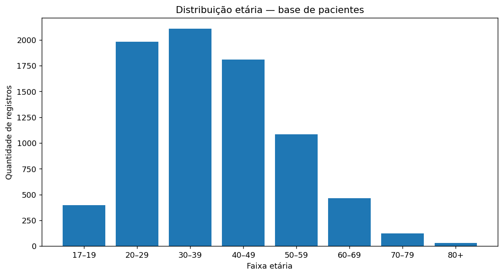
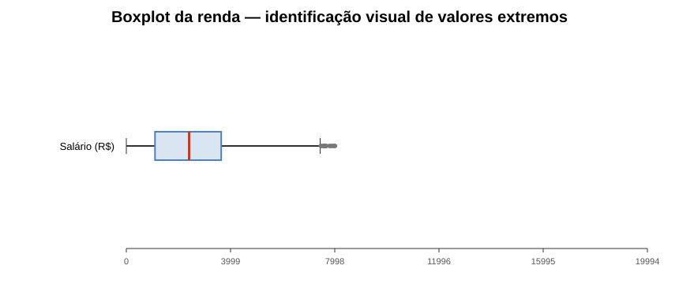
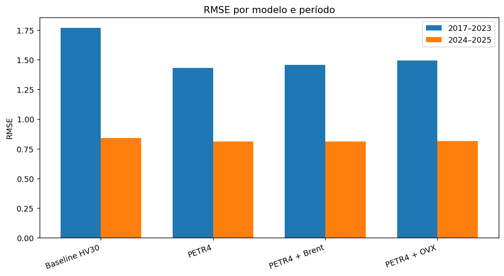

# Portfólio de Análise de Dados, Machine Learning e Séries Temporais

Repositório de projetos selecionados em **Data Analysis, Data Science, Machine Learning e séries temporais**, desenvolvido como parte da evolução profissional e acadêmica de Álvaro Bonifácio.

O objetivo é reunir estudos reproduzíveis e tecnicamente documentados, com atenção a preparação de dados, validação, prevenção de *data leakage*, comparação com baselines e interpretação responsável dos resultados.

## Resultados e visualizações

Os gráficos a seguir foram **extraídos das saídas originais dos notebooks publicados**, sem simulação de dados nem reprocessamento das análises.

### ETL e exploração de dados clínicos e demográficos

| Distribuição das idades | Dispersão dos salários |
| :---: | :---: |
|  |  |

**Interpretação:** o histograma permite analisar a distribuição etária da amostra; o boxplot evidencia dispersão e possíveis observações extremas na variável de renda. Esses indicadores ajudam a direcionar as decisões de preparação, mas não substituem a análise da origem dos valores.

### PETR4, Brent e OVX — avaliação temporal



**Interpretação:** a comparação entre o baseline e modelos com variáveis próprias e externas evidencia que incluir Brent ou OVX não implica, por si só, ganho preditivo. A avaliação deve considerar as janelas temporais e a estabilidade fora da amostra.

[Notebook de ETL/EDA](projetos/01_ETL_EDA_Dados_Clinicos.ipynb) · [Notebook PETR4/Brent/OVX](projetos/02_MD_PETR4_Brent_OVX.ipynb)

## Projetos

### 1. ETL e análise exploratória de dados clínicos e demográficos
📓 `projetos/01_ETL_EDA_Dados_Clinicos.ipynb`

Case introdutório de engenharia e análise de dados com múltiplas fontes.

Principais tópicos:
- leitura e integração de arquivos CSV;
- identificação de valores ausentes;
- junções entre tabelas;
- organização modular de funções em Python;
- preparação dos dados para análises posteriores.

> Os dados utilizados neste case são dados didáticos do projeto original e não representam prontuários reais.

---

### 2. PETR4 × Brent × OVX — previsão de volatilidade
📓 `projetos/02_MD_PETR4_Brent_OVX.ipynb`

Estudo derivado das atividades de **Mineração de Dados** do Mestrado em Ciência da Computação.

Objetivo:
avaliar se informações externas associadas ao mercado de petróleo acrescentam capacidade preditiva à volatilidade futura da PETR4.

Aspectos metodológicos:
- dados diários de PETR4, Brent e OVX;
- construção temporal de atributos;
- horizonte futuro de cinco pregões;
- comparação com baseline histórico;
- validação *walk-forward*;
- controle explícito de vazamento temporal;
- avaliação por MAE, RMSE e R².

O trabalho evidencia um ponto importante em Ciência de Dados: **relação econômica entre variáveis não implica necessariamente ganho preditivo incremental**.

---

### 3. Aprendizado de Máquina — repositório dedicado

O estudo de **PETR4 e USD/BRL para previsão de volatilidade** foi transferido para o repositório público [Aprendizado-de-Maquina](https://github.com/alvarobonifacio1980/Aprendizado-de-Maquina), onde serão centralizados os trabalhos dessa disciplina e os futuros experimentos de séries temporais e aprendizado profundo.

[Ver o notebook original de AM](https://github.com/alvarobonifacio1980/Aprendizado-de-Maquina/blob/main/01_previsao_volatilidade/03_AM_PETR4_USDBRL.ipynb)

---

### 4. Pesquisa em andamento — volatilidade intradiária da PETR4

A linha atual de pesquisa do mestrado investiga a **previsão da volatilidade realizada nos próximos 60 minutos de negociação**, utilizando dados intradiários e comparando abordagens estatísticas, econométricas, Machine Learning e Deep Learning.

O projeto permanece em desenvolvimento e, por isso, resultados intermediários ainda não são publicados neste repositório como conclusões definitivas.

Entre os tópicos investigados estão:

- construção e auditoria de dados intradiários;
- volatilidade realizada;
- baselines estatísticos;
- Random Forest e XGBoost;
- Deep Learning;
- modelos híbridos e ensembles;
- validação temporal;
- QLIKE e outras métricas específicas de volatilidade.

---

## Como reproduzir os estudos

Requer Python 3.11+ e acesso às fontes de dados quando o notebook utilizar séries adquiridas online. A partir da raiz do repositório:

```bash
python -m pip install -r requirements.txt
python -m jupyter notebook
```

Abra o notebook desejado em `projetos/` e execute suas células na ordem apresentada. As bases didáticas utilizadas no estudo de ETL estão em `data/raw/`. As imagens incluídas neste README são as saídas originais dos notebooks, não resultados reprocessados nesta atualização.

**Dados e responsabilidade:** os arquivos didáticos não devem ser interpretados como registros clínicos reais. Antes de reutilizar os CSVs fora deste portfólio, verifique a licença e a proveniência da fonte original. O estudo da PETR4 depende de dados históricos e das regras temporais explicitadas no próprio notebook.

## Tecnologias

`Python` · `Pandas` · `NumPy` · `Scikit-learn` · `Matplotlib` · `Jupyter Notebook` · `SQL`

Conceitos aplicados:

`EDA` · `ETL` · `Machine Learning` · `Time Series` · `Walk-Forward Validation` · `Feature Engineering` · `Data Leakage Prevention`

## Estrutura

```text
Analise-de-Dados/
├── projetos/
│   ├── 01_ETL_EDA_Dados_Clinicos.ipynb
│   └── 02_MD_PETR4_Brent_OVX.ipynb
├── data/
│   └── raw/
├── src/
│   ├── data_cleaning/
│   └── data_loader/
├── doc/
├── requirements.txt
└── README.md
```

## Boas práticas adotadas nos projetos mais recentes

- separação temporal entre desenvolvimento e teste;
- criação de atributos somente com informações disponíveis no momento da previsão;
- prevenção de *data leakage*;
- uso de baselines;
- comparação de modelos com métricas consistentes;
- reprodutibilidade com sementes e versões documentadas;
- distinção entre associação preditiva e causalidade.

---

Este repositório é atualizado à medida que novos experimentos atingem maturidade suficiente para publicação.

## Licenciamento e dados

Os notebooks e scripts estão públicos para estudo e avaliação, mas **ainda não há licença de reutilização definida para o código**. Os CSVs possuem proveniência e condições de uso próprias, que precisam ser confirmadas antes de redistribuição em novos projetos; a publicação neste repositório não altera esses direitos.
