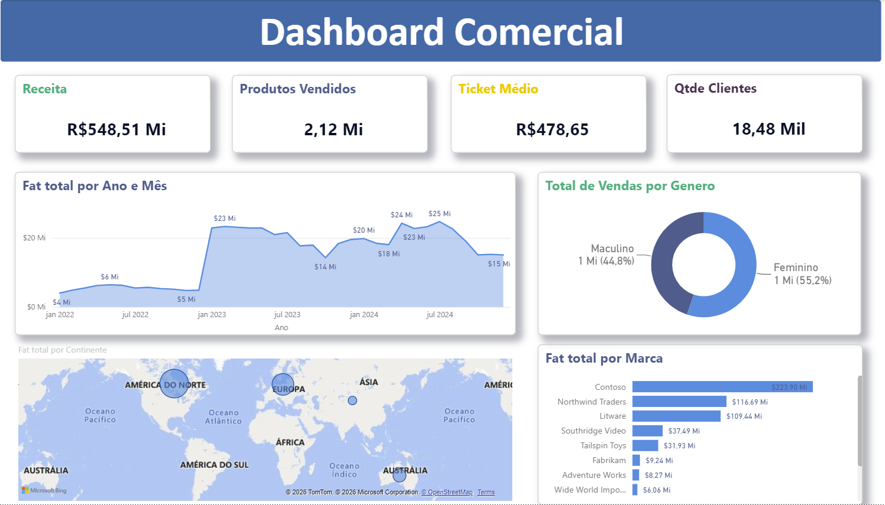
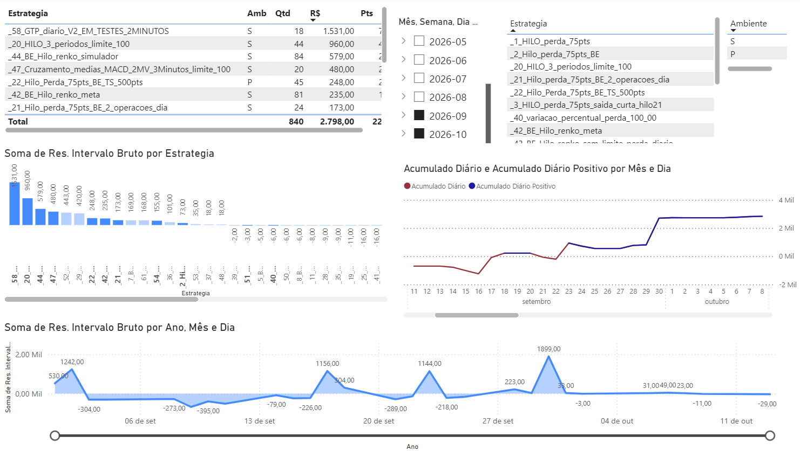
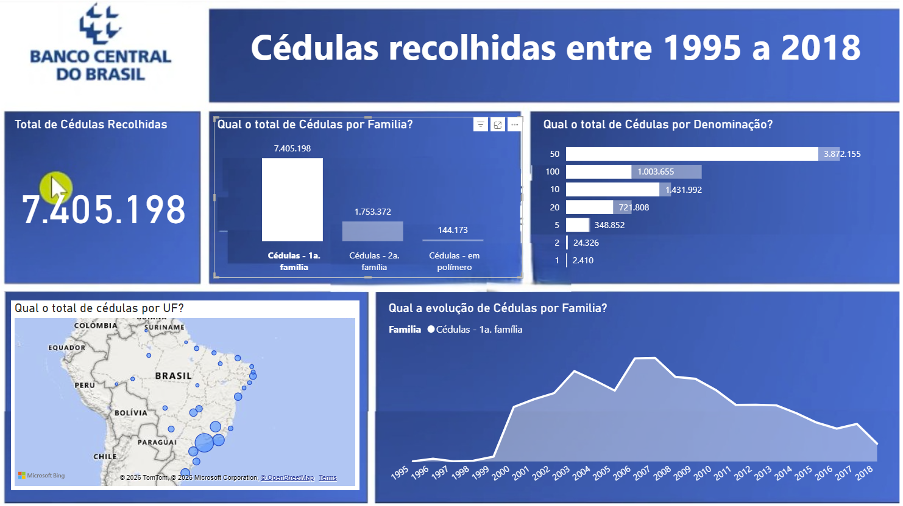
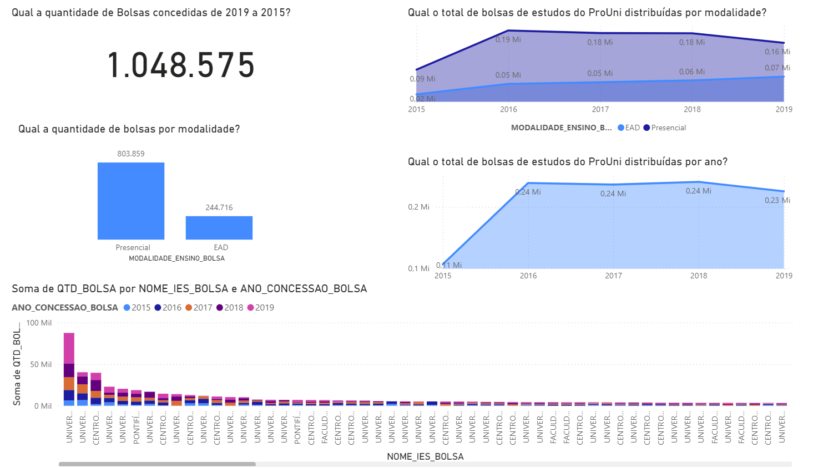

# Power BI | Dashboards e Análise de Dados

Projetos de Business Intelligence voltados à organização, exploração e apresentação de informações para apoiar decisões. Os dashboards abordam indicadores comerciais, análise financeira, dados educacionais e distribuição geográfica de registros.

## O que os dashboards ajudam a investigar

| Painel | Pergunta de análise | Indicadores e dimensões disponíveis |
|---|---|---|
| [Dashboard Comercial](dashboard-comercial/README.md) | Como evoluem as vendas e quais segmentos se destacam? | Receita, ticket médio, marcas, períodos, localização e perfil de clientes |
| [Ranking de Estratégias](ranking-estrategias/README.md) | Como comparar estratégias por desempenho e período? | Resultados, acumulados, intervalos e segmentação temporal |
| [Falsificações](falsificacoes/README.md) | Onde e quando se concentram registros e quais categorias predominam? | Período, estado, família e denominação |
| [ProUni](prouni/README.md) | Como se distribuem as bolsas educacionais? | Ano, instituição, curso, modalidade e perfil dos beneficiários |

**Apresentação profissional:** as perguntas descrevem recursos de exploração dos painéis. Não significam que uma relação causal ou um efeito gerencial tenha sido comprovado.

## Projetos

### [Dashboard Comercial](dashboard-comercial/README.md)

**Análise de vendas e desempenho comercial**

Painel gerencial com indicadores de receita, produtos vendidos, ticket médio e clientes. Explora tendências mensais de faturamento, desempenho de marcas, distribuição geográfica das vendas e perfil dos consumidores.

**Recursos:** indicadores de desempenho, gráficos temporais, mapas, segmentações e matrizes analíticas.

### [Ranking de Estratégias](ranking-estrategias/README.md)

**Análise comparativa de estratégias do mercado financeiro**

Relatório voltado à comparação de resultados de estratégias de negociação, combinando evolução temporal, resultados por intervalo e análises de desempenho acumulado.

**Recursos:** gráficos comparativos, séries temporais, tabelas de resultados e filtros por período e estratégia.

### [Falsificações](falsificacoes/README.md)

**Análise temporal e geográfica de registros de falsificações**

Dashboard organizado em visões estratégica, tática e operacional, permitindo explorar quantidades por período, localização, família e denominação.

**Recursos:** mapas, indicadores, gráficos comparativos e filtros para diferentes níveis de análise.

### [ProUni](prouni/README.md)

**Exploração de dados de bolsas educacionais**

Painel para consulta e comparação de bolsas por ano de concessão, instituição, curso, modalidade de ensino e características dos beneficiários.

**Recursos:** indicadores agregados, gráficos e segmentações para exploração dos dados.

## Competências aplicadas

**Power BI** · Dashboards gerenciais · Indicadores e métricas de negócio · Visualização de dados · Análise temporal · Segmentação · Exploração multidimensional

Os painéis representam **projetos de BI e análise de dados**, ao lado das iniciativas em Python e Machine Learning disponíveis no [portfólio principal](../README.md).
