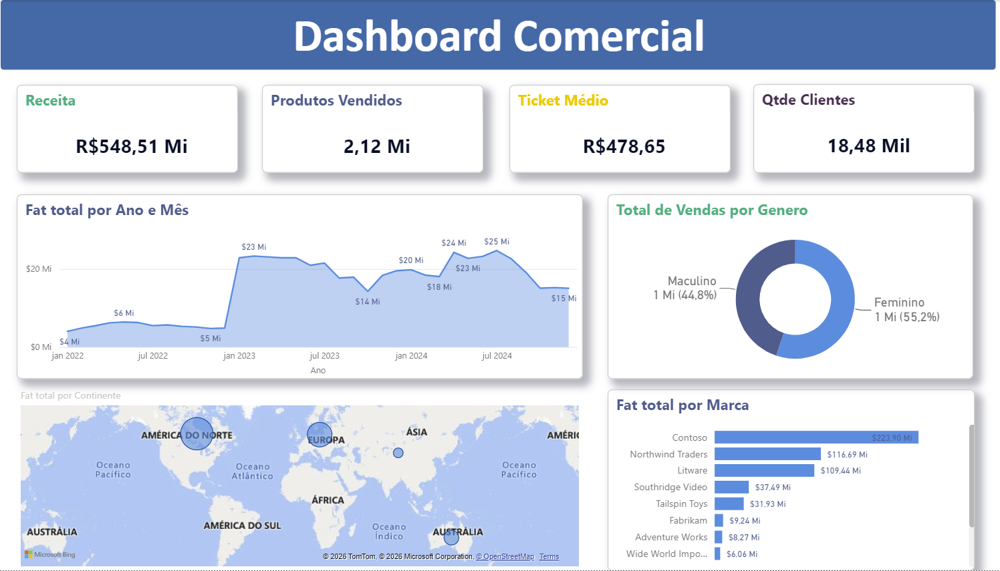
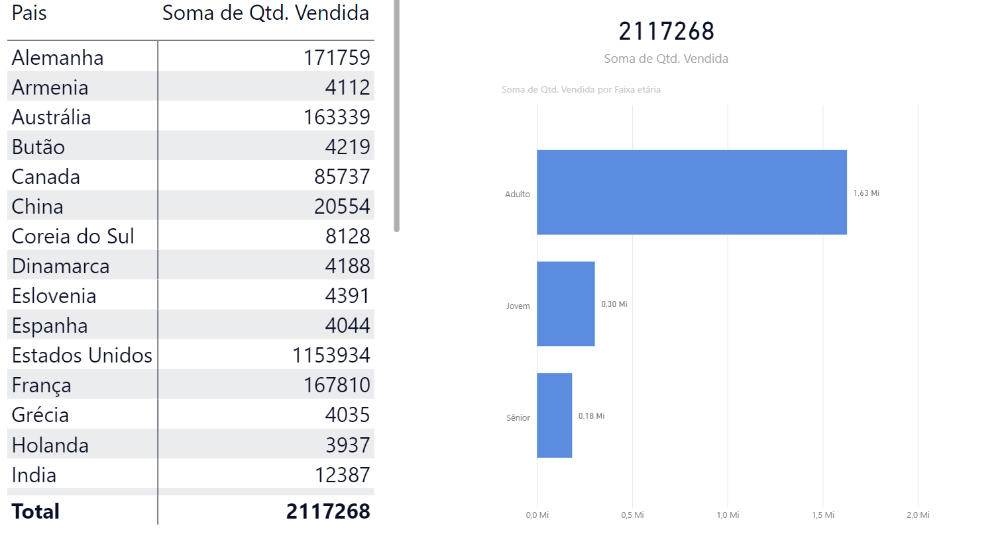
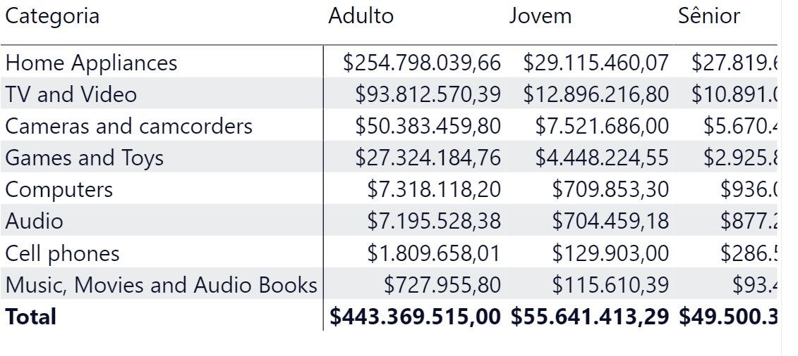

# Case de Business Intelligence — Desempenho Comercial

**Power BI · Análise de Vendas · Indicadores Gerenciais · Visualização de Dados**

## O desafio

Transformar informações de **vendas, produtos, clientes e lojas** em uma visão gerencial que ajude a acompanhar resultados e explorar diferenças entre períodos, marcas, regiões e perfis de consumidores.

Em vez de apresentar apenas tabelas com transações, o projeto organiza **indicadores executivos e perspectivas de análise** em um dashboard.

## A entrega

Painel desenvolvido no **Power BI**, com **quatro páginas e 19 elementos visuais**, incluindo indicadores, gráficos temporais, comparações por categoria e marca, mapa e matrizes. O conjunto analisado no relatório cobre o período **2022–2024**.

### Visão executiva — desempenho geral

**O que observar:** indicadores resumidos facilitam uma leitura inicial dos resultados; os gráficos de evolução e a comparação por marcas permitem identificar períodos e segmentos que merecem investigação mais detalhada.

### Distribuição geográfica e perfil de clientes

**O que observar:** a distribuição geográfica e o cruzamento com faixas etárias ajudam a explorar diferenças entre mercados e grupos de consumidores. 

### Categorias de produtos e faixas etárias

**O que observar:** os cruzamentos entre produtos e perfis de clientes permitem formular hipóteses sobre a composição das vendas. 

## Perguntas de negócio e indicadores

| Pergunta gerencial | Indicadores ou dimensões utilizados | Aplicação prática |
|---|---|---|
| Como o desempenho comercial varia no tempo? | Receita e faturamento mensal | Acompanhar períodos de crescimento ou retração e investigar sazonalidade |
| Quais marcas e categorias têm maior participação? | Receita por marca e categoria; produtos vendidos | Priorizar análises de portfólio de produtos |
| Como as vendas se distribuem por localidade? | Continente, país e faturamento | Comparar mercados e identificar diferenças regionais |
| Quais grupos de clientes aparecem nas vendas? | Faixa etária e gênero | Examinar a composição dos segmentos atendidos |
| Como acompanhar qualidade e canal de venda? | Devoluções e vendas on-line | Monitorar indicadores complementares de operação comercial |
| Qual é a visão geral para acompanhamento gerencial? | Receita, total de vendas, ticket médio e clientes | Concentrar indicadores executivos em uma mesma interface |

## Abordagem de análise

1. **Organização dos indicadores:** leitura conjunta de vendas, clientes, produtos e lojas.
2. **Visão executiva:** indicadores consolidados para identificar rapidamente pontos de atenção.
3. **Exploração multidimensional:** comparações por tempo, marca, geografia, categoria e perfil de cliente.
4. **Aprofundamento:** cruzamentos e filtros para passar de um indicador agregado a perspectivas mais específicas.

## Competências demonstradas

**Power BI · Business Intelligence · Construção de dashboards · Indicadores de desempenho (KPIs) · Análise comercial · Séries temporais · Segmentação de clientes · Visualização gerencial · Comunicação de dados.**

---

[← Voltar à coleção de dashboards Power BI](../README.md) · [← Voltar ao portfólio de Análise de Dados](../../README.md)
