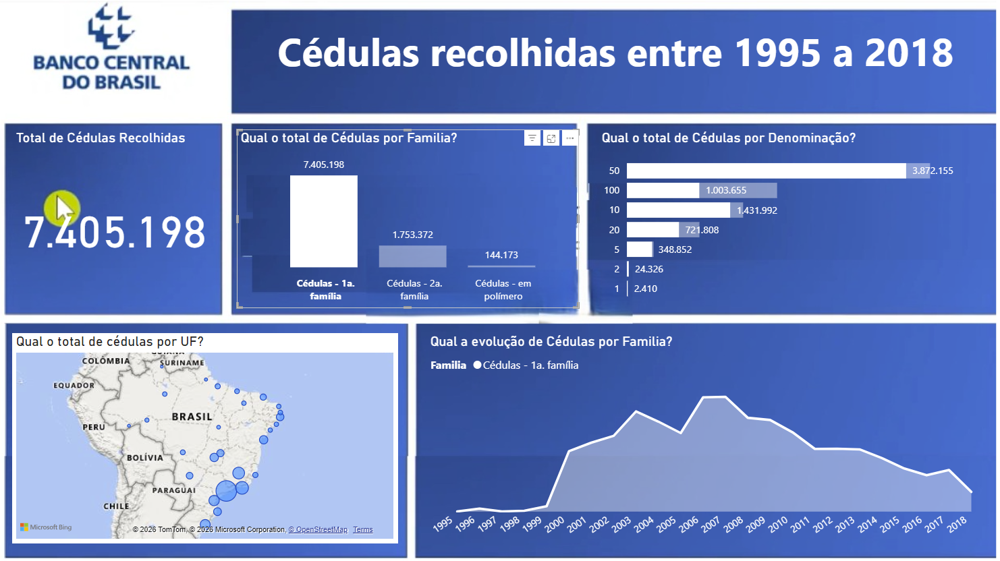
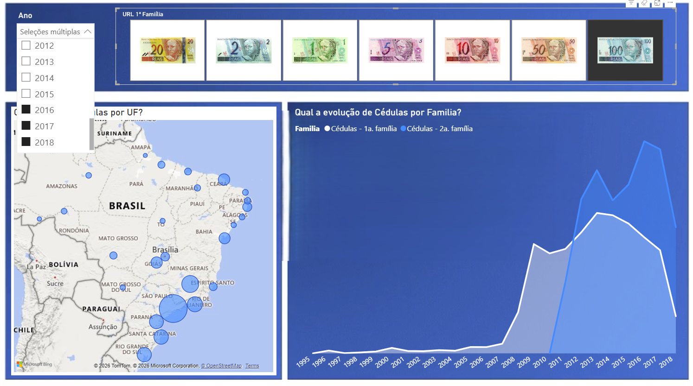
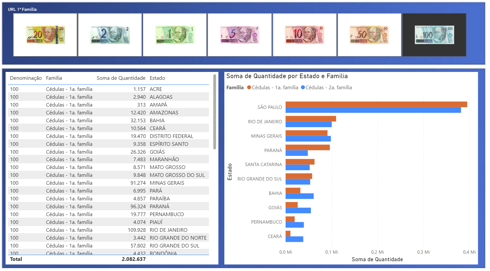

# Análise de Falsificações

**Power BI | Análise Exploratória | Indicadores Geográficos**

## Visualizações

### Visão estratégica

### Visão tática

### Visão operacional

## Visão geral

Dashboard para exploração de registros de falsificações, com análises por período, localização e características dos itens. A estrutura apresenta diferentes níveis de detalhamento, da visão gerencial até a consulta operacional.

## Indicadores e análises

- **Evolução temporal:** acompanhamento de quantidades por ano.
- **Distribuição geográfica:** análise de registros por estado.
- **Composição dos registros:** segmentação por família e denominação.
- **Visão estratégica:** apresentação de indicadores agregados.
- **Visões tática e operacional:** detalhamento dos registros para investigação dos dados.

## Estrutura do dashboard

O projeto conta com **quatro páginas**, organizadas em perspectivas estratégica, tática, operacional e de orientação de uso, com **14 elementos visuais** entre gráficos, mapas, indicadores, tabelas e filtros.

## Aplicações

Exploração de bases de registros, análise geográfica e temporal e apresentação de informações em diferentes níveis de decisão.

**Tecnologias e recursos:** Power BI, análise exploratória de dados, mapas, gráficos comparativos e segmentações.

[← Voltar aos projetos Power BI](../README.md)
