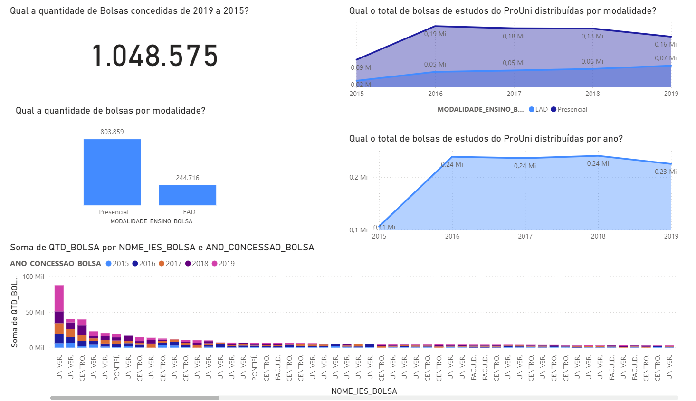
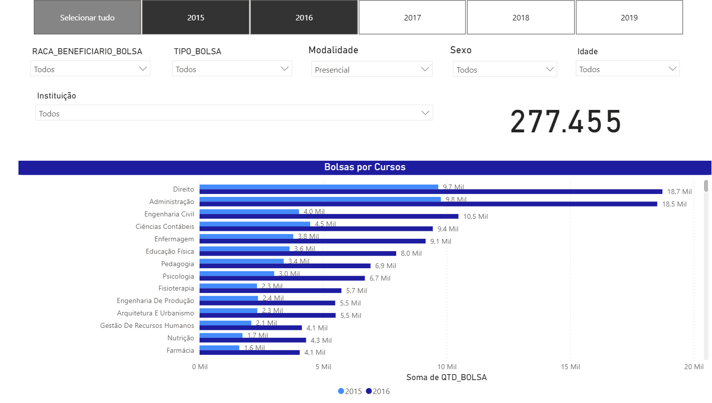

# ProUni — Análise de Bolsas Educacionais

**Power BI | Indicadores Educacionais | Análise Exploratória**

## Visualizações

### Visão geral

### Filtros e análises por curso

## Visão geral

Dashboard de análise de dados de bolsas educacionais, com recursos de consulta por período, instituição de ensino, curso, modalidade e perfil dos beneficiários.

## Indicadores e análises

- **Quantidade de bolsas:** acompanhamento do volume de concessões.
- **Evolução anual:** comparação por ano de concessão.
- **Instituições e cursos:** exploração da distribuição das bolsas.
- **Modalidades e tipos de bolsa:** segmentação dos registros por características da concessão.
- **Perfil dos beneficiários:** análises por idade, sexo e raça/cor, conforme os campos disponíveis na base.

## Estrutura do dashboard

O projeto possui **duas páginas** e **14 elementos visuais**, incluindo cartões, gráficos de barras, colunas e área e sete segmentadores para navegação e filtros.

## Aplicações

Consulta de indicadores educacionais, exploração de distribuições e comparação de grupos por meio de filtros interativos.

**Tecnologias e recursos:** Power BI, análise exploratória, indicadores agregados e segmentação de dados.

[← Voltar aos projetos Power BI](../README.md)
