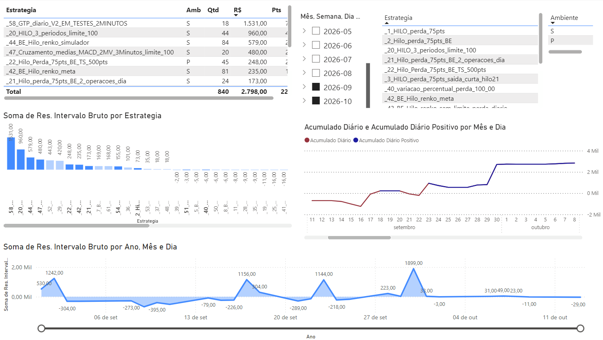

# Ranking de Estratégias

**Power BI | Mercado Financeiro | Análise Quantitativa**

## Dashboard

## Visão geral

Dashboard dedicado à comparação de estratégias de negociação no mercado financeiro. O relatório organiza resultados operacionais e sua evolução temporal, permitindo analisar diferentes estratégias, ambientes e períodos.

## Indicadores e análises

- **Comparação entre estratégias:** consulta de resultados por estratégia e ambiente.
- **Resultados por intervalo:** visualização de resultados brutos e percentuais.
- **Acumulados diários:** acompanhamento da evolução dos resultados ao longo do tempo.
- **Quantidade de compras:** comparação de volumes operacionais.
- **Análise temporal:** segmentações por ano, mês, semana e dia da semana.

## Estrutura do dashboard

O relatório contém **uma página com sete elementos visuais**, incluindo gráficos de linhas, colunas e área, tabelas comparativas e segmentação de dados.

## Aplicações

Organização de indicadores quantitativos, comparação de estratégias operacionais e investigação da evolução temporal de resultados.

**Tecnologias e recursos:** Power BI, análise de séries temporais, métricas financeiras e visualização comparativa.

[← Voltar aos projetos Power BI](../README.md)
