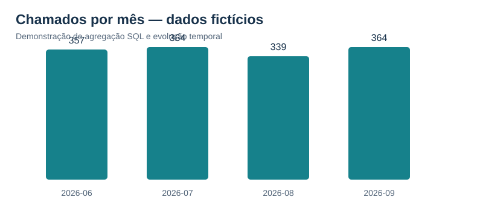
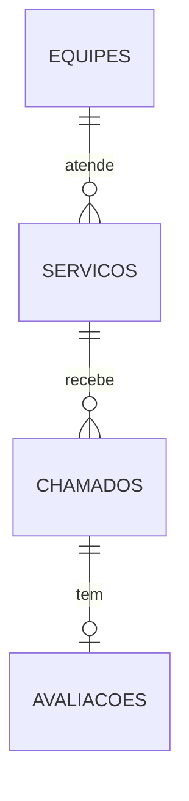

# SQL aplicado — indicadores e gestão de serviços de TI

**SQL · Modelagem relacional · Business Intelligence · Indicadores de serviços · Desempenho de consultas**

## O problema de negócio

Como transformar registros operacionais de serviços de TI em indicadores para gestão? Este projeto fictício permite avaliar **volume de chamados, prioridades, cumprimento de metas de SLA, backlog, satisfação e evolução temporal**.

O case utiliza **dados sintéticos de serviços de TI** para apresentar consultas orientadas à tomada de decisão.



## Dez consultas com perguntas e interpretações

| Etapa | Questão investigada | Técnica aplicada |
|---|---|---|
| [01 — Volume por equipe](consultas/01_volume_por_equipe.sql) | Quais equipes concentram mais registros? | `LEFT JOIN`, `GROUP BY` e `COUNT` |
| [02 — Prioridades](consultas/02_perfil_de_prioridades.sql) | Quais prioridades predominam por serviço? | Agregação condicional com `CASE` |
| [03 — Indicadores de SLA](consultas/03_cumprimento_sla.sql) | Quais serviços têm maior proporção de incidentes fora da meta? | CTE, vista, filtro e agregações |
| [04 — Evolução mensal](consultas/04_tendencia_mensal.sql) | O volume aumentou ou caiu frente ao mês anterior? | `LAG()` e CTEs |
| [05 — Ranking de violações](consultas/05_ranking_violacao_sla.sql) | Quais serviços concentram desvios? | `DENSE_RANK()` |
| [06 — Idade do backlog](consultas/06_backlog_por_idade.sql) | Quais equipes têm chamados antigos ainda abertos? | Datas, segmentação e `CASE` |
| [07 — Avaliações e SLA](consultas/07_satisfacao_e_sla.sql) | Como variam as avaliações entre grupos? | Relacionamento entre tabelas, `AVG` |
| [08 — Concentração de demanda](consultas/08_pareto_servicos.sql) | Que serviços representam a maior parte do volume? | `SUM() OVER`, acumulados e participação |
| [09 — Média móvel](consultas/09_media_movel_diaria.sql) | Como evolui a demanda diária? | `AVG() OVER` com janela de sete dias |
| [10 — Plano de execução](consultas/10_plano_e_indices.sql) | Qual estratégia de acesso o banco usa? | Índices e `EXPLAIN QUERY PLAN` |

[**Consultar resultados reais de execução sobre dados sintéticos**](RESULTADOS.md)

## Estrutura e modelagem

O exemplo utiliza quatro entidades com **chaves primárias, estrangeiras, restrições e índices**:



Uma *view* (`vw_metricas_chamados`) padroniza a interpretação das metas ilustrativas por prioridade e calcula tempo de resolução e cumprimento de SLA. Chamados abertos **não entram** no denominador da taxa de cumprimento: compõem o backlog.

## Executar localmente

O case foi implementado para **SQLite 3.25+**, por ser gratuito, leve e executável apenas com a biblioteca padrão do Python. Não há instalação de servidor nem dependências externas.

```bash
# Execute os comandos dentro da pasta sql/operacao_servicos_ti
python gerar_base.py
python executar_consultas.py
python -m unittest testar_case.py -v
```

O primeiro comando cria um banco local (`operacao_exemplo.sqlite`) com dados **100% artificiais e determinísticos**, de junho a setembro de 2026. O segundo gera o resumo e o gráfico em `RESULTADOS.md` e `figuras/volume_mensal.svg`. O terceiro valida integridade, regras de negócio e execução das dez consultas.

Se quiser gerar a base novamente, remova **somente** o arquivo local `operacao_exemplo.sqlite` e execute o primeiro comando. O gerador **não sobrescreve um arquivo existente**.

## Boas práticas aplicadas

- Nomes de tabelas e campos organizados em português e `snake_case`, com chaves e relacionamentos explícitos.
- Restrição de domínio com `CHECK`, chave estrangeira e índices voltados a filtros usuais.
- Consultas legíveis e orientadas a perguntas de negócio, sem `SELECT *` indiscriminado.
- CTEs, funções de janela e agregações condicionais.
- Separação entre **dados abertos**, **chamados resolvidos** e **avaliações recebidas**, evitando denominadores inconsistentes.
- Separação entre **associação descritiva e causalidade**; não há inferência causal a partir das notas.
- Dados simulados isolados do portfólio, gerador determinístico e testes automáticos.
- Uso de parâmetros (`?`) nas operações de inserção em Python e separação entre código e dados, evitando concatenação direta de entradas em SQL.
- Aplicação de restrições de integridade, índices e parametrização, com práticas de segurança no acesso aos dados.

**Portabilidade:** as consultas se apoiam em conceitos SQL amplamente utilizados, mas há funções específicas do SQLite (`strftime`, `julianday` e `EXPLAIN QUERY PLAN`). Em PostgreSQL, MySQL e Oracle, algumas funções temporais e ferramentas de inspeção têm sintaxes próprias.

[← Voltar ao portfólio de Análise de Dados](../../README.md)
