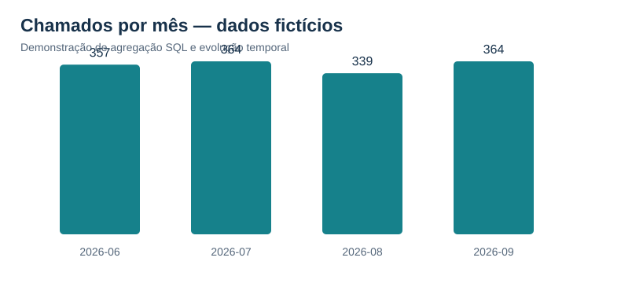

# Resultados — base 100% fictícia

Resultados das **10 consultas SQL executadas sobre dados sintéticos**, com indicadores de atendimento e gestão de serviços.

**Escala:** 1424 chamados simulados; 65 abertos no corte de 01/10/2026; 835 avaliações associadas.

## Volume por equipe

**Pergunta:** Qual equipe concentra mais chamados?

| equipe | total_chamados |
| --- | --- |
| Sistemas | 472 |
| Integrações | 413 |
| Plataformas | 355 |
| Operações | 184 |

## Perfil de prioridades

**Pergunta:** Qual é o perfil das prioridades em cada serviço?

| servico | p1 | p2 | p3 | p4 | total |
| --- | --- | --- | --- | --- | --- |
| Portal de Atendimento | 27 | 64 | 124 | 60 | 275 |
| Integração de Aplicações | 22 | 52 | 98 | 66 | 238 |
| Autenticação | 11 | 52 | 96 | 52 | 211 |
| Cadastro Digital | 14 | 48 | 92 | 43 | 197 |
| Mensageria | 18 | 40 | 86 | 31 | 175 |
| Armazenamento | 13 | 38 | 61 | 32 | 144 |
*Exibindo 6 de 8 linhas.*

## Cumprimento de SLA

**Pergunta:** Quais serviços têm maior incidência de chamados fora da meta?

| servico | total_resolvidos | dentro_da_meta | sla_percentual | tempo_medio_minutos |
| --- | --- | --- | --- | --- |
| Integração de Aplicações | 228 | 115 | 50.4 | 1970.7 |
| Portal de Atendimento | 252 | 144 | 57.1 | 1589.5 |
| Armazenamento | 137 | 82 | 59.9 | 1344.7 |
| Mensageria | 168 | 109 | 64.9 | 1244.6 |
| Monitoramento | 97 | 63 | 64.9 | 1505.0 |
| Portal Interno | 82 | 54 | 65.9 | 1715.2 |
*Exibindo 6 de 8 linhas.*

## Evolução mensal

**Pergunta:** O volume de chamados aumentou ou diminuiu?

| mes | total_chamados | mes_anterior | variacao_percentual |
| --- | --- | --- | --- |
| 2026-06 | 357 | — | — |
| 2026-07 | 364 | 357 | 2.0 |
| 2026-08 | 339 | 364 | -6.9 |
| 2026-09 | 364 | 339 | 7.4 |

## Ranking de violações de SLA

**Pergunta:** Onde estão concentradas as ocorrências fora do prazo?

| servico | resolvidos | violacoes | violacao_percentual | posicao |
| --- | --- | --- | --- | --- |
| Integração de Aplicações | 228 | 113 | 49.6 | 1 |
| Portal de Atendimento | 252 | 108 | 42.9 | 2 |
| Autenticação | 205 | 64 | 31.2 | 3 |
| Cadastro Digital | 190 | 59 | 31.1 | 4 |
| Mensageria | 168 | 59 | 35.1 | 4 |
| Armazenamento | 137 | 55 | 40.1 | 5 |
*Exibindo 6 de 8 linhas.*

## Backlog por idade

**Pergunta:** Qual é o envelhecimento dos chamados ainda abertos?

| equipe | total_abertos | ate_1_dia | de_2_a_7_dias | acima_7_dias |
| --- | --- | --- | --- | --- |
| Sistemas | 30 | 9 | 2 | 19 |
| Integrações | 17 | 1 | 7 | 9 |
| Plataformas | 13 | 2 | 1 | 10 |
| Operações | 5 | 1 | 2 | 2 |

## Avaliações e SLA

**Pergunta:** Como variam as notas dos chamados dentro e fora da meta?

| situacao | avaliacoes_recebidas | nota_media | notas_4_ou_5 |
| --- | --- | --- | --- |
| Dentro do SLA | 514 | 3.94 | 374 |
| Fora do SLA | 321 | 3.41 | 176 |

**Interpretação:** a diferença entre grupos é descritiva e não prova causalidade; a amostra considera apenas chamados avaliados.

## Concentração por serviço

**Pergunta:** Quais serviços respondem pela maior parte da demanda?

| servico | quantidade | percentual | acumulado_percentual |
| --- | --- | --- | --- |
| Portal de Atendimento | 275 | 19.3 | 19.3 |
| Integração de Aplicações | 238 | 16.7 | 36.0 |
| Autenticação | 211 | 14.8 | 50.8 |
| Cadastro Digital | 197 | 13.8 | 64.7 |
| Mensageria | 175 | 12.3 | 77.0 |
| Armazenamento | 144 | 10.1 | 87.1 |
*Exibindo 6 de 8 linhas.*

## Média móvel de sete dias

**Pergunta:** Como varia a demanda diária ao longo do tempo?

| dia | chamados | media_movel_7_dias |
| --- | --- | --- |
| 2026-06-01 | 14 | 14.0 |
| 2026-06-02 | 16 | 15.0 |
| 2026-06-03 | 14 | 14.67 |
| 2026-06-04 | 9 | 13.25 |
| 2026-06-05 | 14 | 13.4 |
| 2026-06-06 | 8 | 12.5 |
*Exibindo 6 de 122 linhas.*

## Plano de execução e índices

**Pergunta:** Qual plano o banco escolhe para a consulta filtrada?

| id | parent | notused | detail |
| --- | --- | --- | --- |
| 5 | 0 | 0 | SEARCH c USING INDEX idx_chamados_servico_status (servico_id=? AND status=?) |
| 22 | 0 | 0 | USE TEMP B-TREE FOR ORDER BY |

## Leitura dos resultados

- **SLA:** a taxa usa somente chamados resolvidos; chamados abertos compõem o backlog e não o denominador de cumprimento.
- **Períodos:** datas e janelas pertencem exclusivamente à simulação de junho a setembro de 2026.
- **Plano de execução:** o resultado do `EXPLAIN QUERY PLAN` pode variar conforme a versão do SQLite e o tamanho da base.

